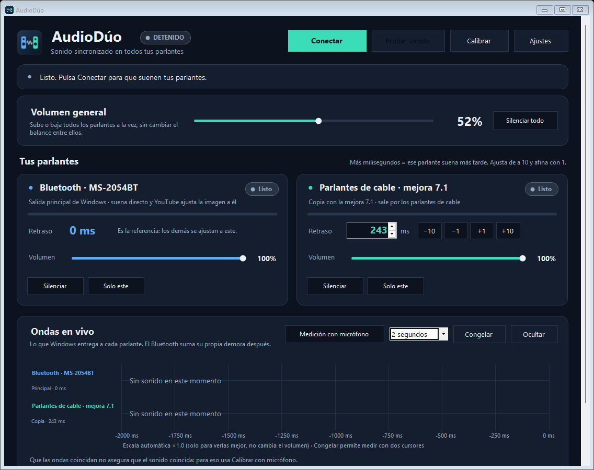

# AudioDúo

**Sonido sincronizado en varios parlantes a la vez en Windows**: un parlante Bluetooth y otros por cable (o más Bluetooth) suenan juntos, sin eco, y a tiempo con los videos.



## El problema que resuelve

Windows solo reproduce por **una** salida a la vez. Si copias el sonido a otro parlante, cada uno llega con distinta demora: los Bluetooth suelen tardar **de 150 a 500 ms**, y los de cable casi nada. El resultado es un eco molesto.

AudioDúo toma el sonido que va al parlante principal, lo copia a los demás y **retrasa cada copia lo justo** para que todos suenen al mismo tiempo.

## Cómo funciona

```
Video / música ──► Parlante principal (salida de Windows, normalmente el Bluetooth)
                        │  el navegador ajusta la imagen a este parlante
                        └─► AudioDúo copia el sonido ──► otros parlantes, cada uno con su retraso
```

- **Modo directo (recomendado):** el Bluetooth más lento es la salida de Windows. Los navegadores compensan su demora con la imagen, así que el video queda a tiempo, y los demás parlantes lo esperan.
- **Modo puente (opcional):** con un cable virtual como [VB-CABLE](https://vb-audio.com/Cable/), que se instala aparte, se pueden retrasar todos los parlantes, incluso varios Bluetooth. En este modo el video **no** se ajusta solo.

### Detalles técnicos

- Captura por *WASAPI loopback* cada ~15 ms y reproduce por *WASAPI* compartido ([NAudio 1.10](https://github.com/naudio/NAudio)).
- Cada salida tiene una **cola de demora fija** (30 ms) con corrección continua de la deriva entre relojes (±0,4 % de velocidad, imperceptible) y conversión de frecuencia propia (por ejemplo, de 48 kHz a 44,1 kHz).
- El retraso se cambia **en vivo**, sin cortar el sonido.
- Calibración opcional con micrófono: tonos identificables, correlación y marcas de tiempo QPC.

## Funciones

- Una tarjeta por parlante con **retraso** (±1 / ±10 ms), **volumen**, **Silenciar**, **Solo este** y medidor de nivel.
- **Volumen general** que sube o baja todos los parlantes sin cambiar el balance entre ellos.
- **Ondas en vivo** de lo que recibe cada parlante y vista de la **última medición con micrófono**.
- **Conexión automática:** al abrirse, o al encender o reconectar un parlante, vuelve a sonar con la configuración guardada.
- Reconoce un parlante **borrado y emparejado de nuevo** (Windows le da otro identificador).
- **Parlantes nuevos:** se agregan solos (con «Deshacer») o se ofrecen para agregarlos; «Quitar apagados» limpia la lista.
- Sigue funcionando junto al reloj (bandeja del sistema) y puede iniciarse con Windows.

## Requisitos

- Windows 10 u 11 (x64).
- .NET Framework 4.x, que ya viene con Windows. No hace falta instalar el SDK de .NET.
- Opcional: un micrófono para calibrar y VB-CABLE para el modo puente.

## Compilar y ejecutar

1. Descarga o clona este repositorio.
2. Ejecuta **`COMPILAR.cmd`**. Usa el compilador de C# incluido en Windows, descarga NAudio 1.10.0 desde NuGet comprobando su huella SHA-256 (`RESTAURAR.ps1`), compila, ejecuta las pruebas automáticas y deja **`AudioDuo.exe`** listo.
3. Abre **`INICIAR.cmd`** (o `AudioDuo.exe`).

Primer uso: en **Ajustes**, elige el parlante principal (el Bluetooth) y la copia (por ejemplo, los parlantes por cable), y pulsa **Conectar**. Ajusta el retraso de la copia con **Probar sonido** hasta oír un solo golpe, o usa **Calibrar** si tienes micrófono.

### Opciones de línea de comandos

| Opción | Uso |
|---|---|
| `--self-test` | Ejecuta las pruebas automáticas y escribe `validacion.txt` |
| `--tray` | Inicia junto al reloj, sin mostrar la ventana |
| `--connect` | Conecta al abrir |
| `--exit-running` | Cierra la instancia que esté abierta |
| `--devices` | Lista las salidas de audio en `dispositivos.txt` |
| `--preview ancho alto archivo [--ajustes]` | Guarda una imagen de la ventana, sin audio ni cambios |

## Estructura

| Carpeta / archivo | Contenido |
|---|---|
| `codigo/` | Código de la aplicación (C# WinForms) |
| `codigo/Elastic.cs` | Cola de demora fija, deriva y conversión de frecuencia |
| `codigo/AudioDuo.cs` | Motor principal, conexión y programa |
| `codigo/Outputs.cs` | Copias, canales y parlantes adicionales |
| `codigo/AutoConnect.cs` | Vigilancia de dispositivos y conexión automática |
| `codigo/MainDesign.cs`, `Overview.cs`, `Settings.cs`, `Design.cs` | Interfaz |
| `codigo/Acoustic*.cs`, `LiveCalibration.cs`, `CalibrationDesign.cs` | Calibración con micrófono |
| `codigo/SignalChecks.cs`, `AcousticChecks.cs` | Pruebas automáticas |
| `herramientas/` | Utilidades de diagnóstico |
| `CAMBIOS.md` | Historial de versiones |
| `LEEME.md` | Notas técnicas de versiones anteriores |

## Limitaciones conocidas

- La demora propia de un parlante Bluetooth no se puede reducir. Algunos parlantes además **cambian su demora por momentos**; si notas desfase, reajusta o calibra de nuevo.
- En modo puente el video no se compensa: el audio llega con la demora del parlante más lento.
- Distribuye estéreo; no separa canales 5.1 reales.
- Está probado en un equipo con un parlante Bluetooth, parlantes por cable y el programa Razer 7.1 Surround Sound. Otros equipos pueden necesitar ajustes.

## Contribuir

¡Las mejoras son bienvenidas! Abre un *issue* para reportar un problema o una idea, o un *pull request* con tu cambio. Los cambios se revisan antes de incorporarse. Antes de proponer uno, ejecuta `COMPILAR.cmd` y comprueba que las pruebas automáticas pasen.

## Licencia

[MIT](LICENSE) © 2026 Arkhon2.
NAudio se distribuye bajo la [Microsoft Public License](LICENCIA-NAudio.txt) y se descarga al compilar; no se incluye en este repositorio. VB-CABLE es software de terceros con su propia licencia y no forma parte de AudioDúo.
